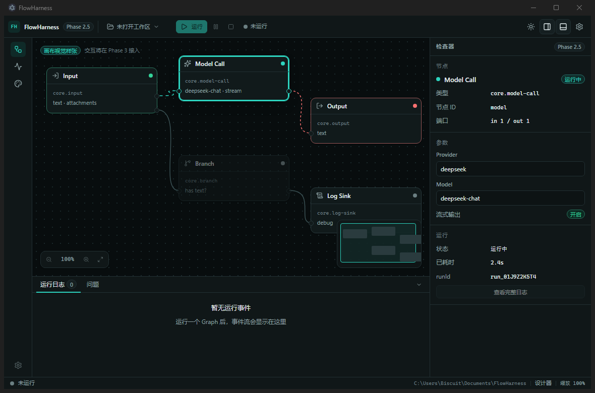
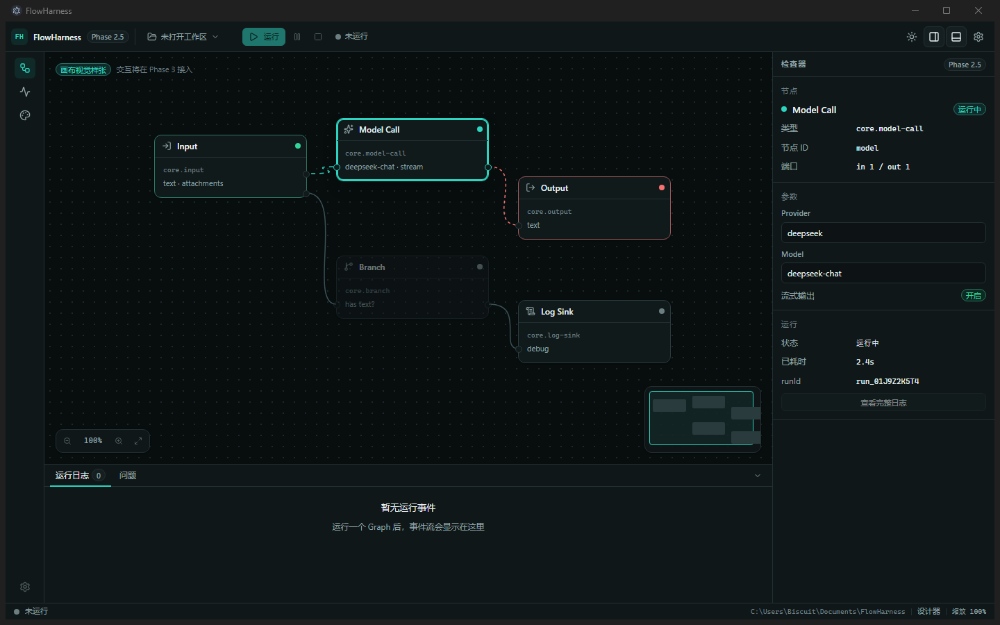

# 2026-11-24 04:20 — UI 评估、截图能力与 Phase 2.6 路线

## 背景

用户反馈当前 UI “太丑”，并希望在功能继续生长前先优化，避免后续返工。已确认：

- 插入 **Phase 2.6：UI 打磨**（2–3 轮，逐轮验收）；
- 视觉方向：用户会提供参考产品/截图；
- 主要痛点：配色与对比、窗口边框与尺寸、图标、布局与留白；
- 允许自动截取 FlowHarness 窗口用于自检。

## 先修掉的客观问题

1. **Electron 默认菜单栏**：窗口顶部出现 `File / Edit / View / Window`，与产品无关。已在 `Menu.setApplicationMenu(null)` 移除。
2. **窗口默认尺寸过小**：1180×780 在“左栏 + 检查器 + 底栏”下让画布只剩 ~740×482，节点被裁切。
   改为按主屏 workArea 自适应：默认 `min(1440, width-80) × min(900, height-80)`，最小 1024×680，居中。
3. **画布样张不缩放**：固定 780×500 场景在窄容器里溢出。加入 `ResizeObserver` 计算 `scale`，按容器等比缩放（下限 0.45）。
4. **左栏图标偏小**：18 → 20，与 TopBar 的 16 拉开层级。

## 截图能力

`webContents.capturePage()` 在受限会话中会挂起，改用 Win32 `PrintWindow(PW_RENDERFULLCONTENT)` 直接抓窗口表面：

```bash
pnpm build
pnpm capture:ui   # -> devlog/assets/ui-current.png
```

注意：本环境 renderer 挂载约需 8s（磁盘缓存被拒），脚本会等待主进程日志出现 `phase":"data"` 后再截图。

## 当前效果对比

修复前（1180×780，画布被裁切，带默认菜单）：



修复后（1440×900，画布完整，无菜单）：



## 仍然明显的问题（待 R1/R2）

- **对比与层级**：背景 / 面板 / 节点过于接近，整体偏“一片黑”；网格与边框可再清晰。
- **留白与重心**：底部面板 200px 但长期为空；画布右下方大片空白；检查器底部空。
- **顶部运行控制**：禁用的“运行”按钮仍是最亮元素，视觉重心错误。
- **图标**：Lucide 线宽/尺寸仍不完全统一，Rail 与 TopBar 的视觉重量不同。
- **窗口**：仍是原生标题栏，未决定是否自绘；需要参考方向。

## 路线

完整 Phase 列表已写入 [todo.md](../todo.md)：

- Phase 2.6（当前）：R1 视觉系统 → R2 画布优先布局 → R3 细节/动效
- Phase 3 Canvas core + view
- Phase 3.5 Harness Designer
- Phase 4 Workbench Framework
- Phase 5 Session / Provider
- Phase 6 模板 / 多工作台
- Phase 7 可观测性 / 工程化
- Phase 8 打包发布
- 远期：云同步 / 协作 / 插件

## 验证

```text
pnpm typecheck → 0
pnpm build     → 0
pnpm capture:ui → captured 1440x900
```

## 下一步

等待用户提供参考产品/截图后开始 R1；每轮结束用 `pnpm capture:ui` 出图确认。
