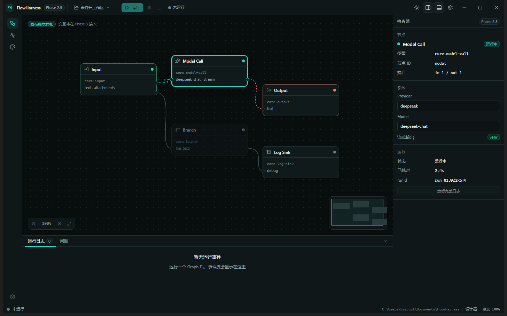

# 2026-11-24 08:10 — S0 窗口 Spike：无边框、材质与透明

## 目标

在 Shell v2 之前确定窗口 chrome：是否无边框、自绘标题栏是否可行、半透明走哪条路线、截图链路是否还能用。

## 实现

- 新增窗口 IPC：`window:minimize` / `window:toggle-maximize` / `window:close` / `window:is-maximized`；
  主进程在 `maximize` / `unmaximize` 时广播 `window` 事件。
- 默认窗口改为 `frame: false`，TitleBar 自绘窗口按钮（最小化/最大化/关闭），支持双击标题栏切换最大化。
- 顶部栏成为拖拽区：`-webkit-app-region: drag`；按钮/输入等交互元素全局 `no-drag`。
- 增加 `FLOWHARNESS_WINDOW_MODE` 实验开关：`frameless`（默认）/ `standard` / `overlay` / `mica` / `acrylic` / `transparent` / `simulated`。
- `capture:ui` 支持 `-WindowMode` 与绝对输出路径，便于逐模式截图。

## 结果

### frameless（采用）



- 无原生标题栏，窗口按钮在右上角；
- 拖拽/双击最大化可用；
- 仍有 `thickFrame` 提供的缩放边缘与阴影；
- 代价：自绘按钮没有 Win11 Snap Layouts 弹层，需要接受或改用 overlay。

### overlay（备选）


- `titleBarOverlay` 保留原生最小化/最大化/关闭，Snap Layouts 可用；
- 但按钮样式受系统控制，和自绘 UI 不完全一致；
- 作为“必须保留 Snap”的 fallback。

### standard（基线）

原生标题栏 + 应用内 TopBar，视觉割裂，不作为方向。

### 透明 / 材质

- `transparent: true` + 高不透明度表面 + `backdrop-filter: blur(22px)` **可用**：桌面内容被模糊扩散，正文仍可读；
- 但透明窗口在阴影、缩放、截图链路上不稳定；`PrintWindow` 抓不到 DWM 合成后的桌面背景，只能前台抓屏验证；
- `mica` / `acrylic` 在当前机器（Win11 26H2）没有可辨收益，截图与 frameless 接近，暂不作为默认；
- 结论：**默认不透明 frameless**，透明模式保留为 `FLOWHARNESS_WINDOW_MODE=transparent` 实验分支，step 4 再决定是否默认开启。

## 验证

```text
pnpm typecheck → 0
pnpm test      → 9 files / 40 tests
pnpm build     → 0
pnpm smoke     → OK（window mode=frameless transparent=false）
pnpm capture:ui -WindowMode frameless / overlay / standard → 1440×900
```

## 未完成 / 移交 Shell v2

- 窗口 bounds 持久化（含多显示器/DPI 校正）；
- 菜单与快捷键接管（Ctrl+W 等）；
- 标题栏与菜单/命令中心合并；
- 透明模式下的阴影/缩放回归。

## 备注

- 透明/材质的对比截图涉及真实桌面内容，未入库；`s0-frameless`、`s0-overlay`、`s0-standard` 仅包含应用窗口。
- `capture:ui` 的 `PrintWindow` 对 DWM 材质不可见，后续视觉验收默认用 `frameless`。
