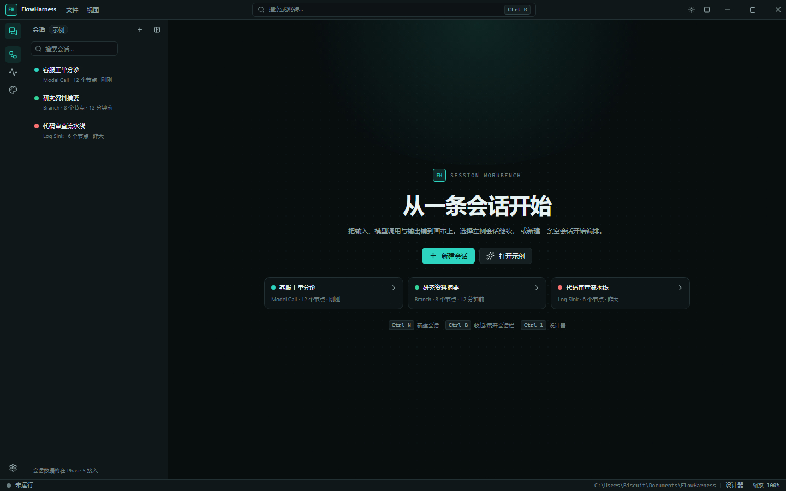
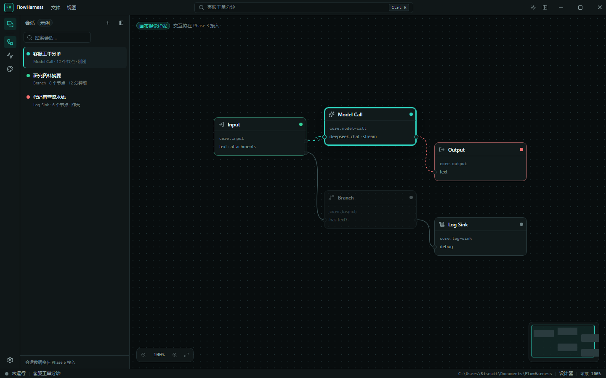
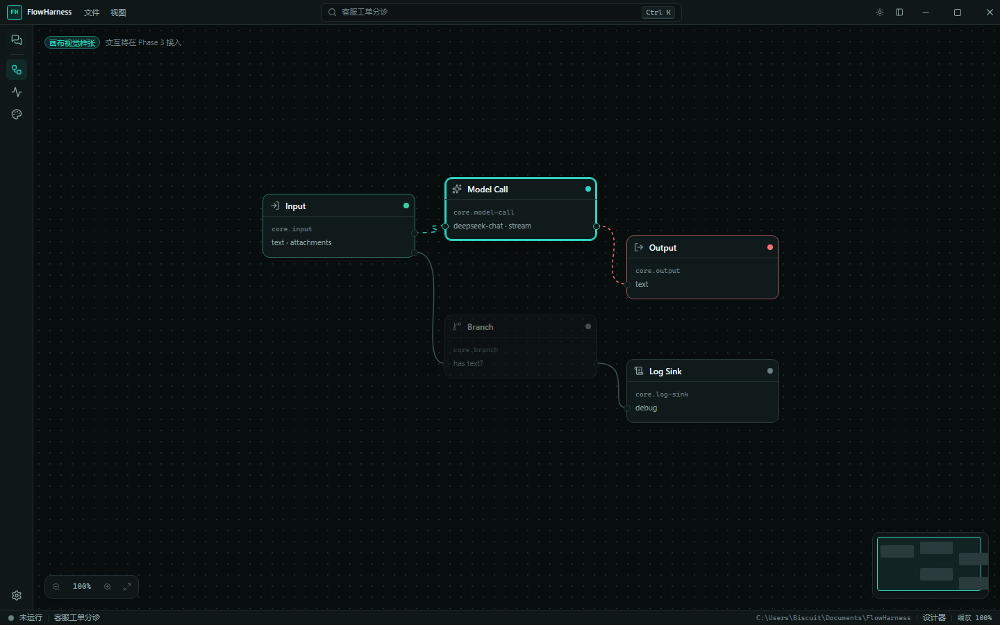

# 2026-11-24 08:35 — Shell v2：VS Code 式布局

## 目标

把 Phase 2.5 的六区外壳替换为 VS Code 式工作台：

```text
TitleBar 36
├ Ribbon 48 + Session Sidebar 260 + Main
StatusBar 22
```

固定 Inspector / BottomPanel 先移除，留给 step 2 的内部浮动 Panel。

## 实现

### TitleBar

- 品牌、文件/视图菜单、命令中心（Ctrl K 打开命令菜单）；
- 主题、侧栏开关、自绘窗口按钮；
- 整条标题栏可拖拽，交互元素自动 `no-drag`，双击空白处最大化。

### Ribbon

- 会话栏开关 + 设计器 / 诊断 / 样式指南；
- 底部设置菜单（主题 / 样式指南）；
- active 使用 accent-soft + accent 图标。

### Session Sidebar

- 260px，可收起、可拖宽（200–360），宽度与开关写入 localStorage；
- 搜索、示例徽章、新建会话、会话状态点；
- mock 会话数据按未来 `SessionSummary` 字段设计，Phase 5 替换。

### Main

- 无选中会话：Hero（新建会话 / 打开示例 / 三张模板卡 / 快捷键提示）；
- 选中会话：全宽 CanvasPreview（静态样张），滚动与缩放自适应；
- 诊断 / 样式指南沿用原视图。

### 快捷键

`Ctrl N` 新建会话、`Ctrl B` 切换侧栏、`Ctrl W` 关闭窗口、
`Ctrl K` 命令中心、`Ctrl 1/2/3` 切换视图。

## 交互验证（CDP）

```text
aside before: true
click session → canvas: true
collapse → aside after: false, main width 1392
reopen → aside after: true, main width 1192
```

## 截图

Hero：



画布（选中会话）：



收起侧栏：



## 工具链调整

`pnpm capture:ui` 改为默认通过 CDP `Page.captureScreenshot` 抓 renderer：

- 不再受窗口遮挡、动画画布合成影响；
- 输出 1440×900，不含原生窗口框；
- 需要原生框/系统按钮对比时加 `-NativeWindow`（PrintWindow）。

## 验证

```text
pnpm typecheck → 0
pnpm test      → 9 files / 40 tests
pnpm build     → 0
pnpm smoke     → OK
```

## 待补 / 下一步

- 窗口 bounds 持久化（多显示器/DPI）——step 2 开头补；
- 浮动 Panel：运行日志、属性检查（step 2）；
- Canvas 视觉与交互（step 3）。
