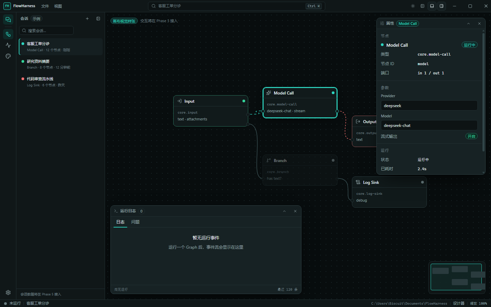
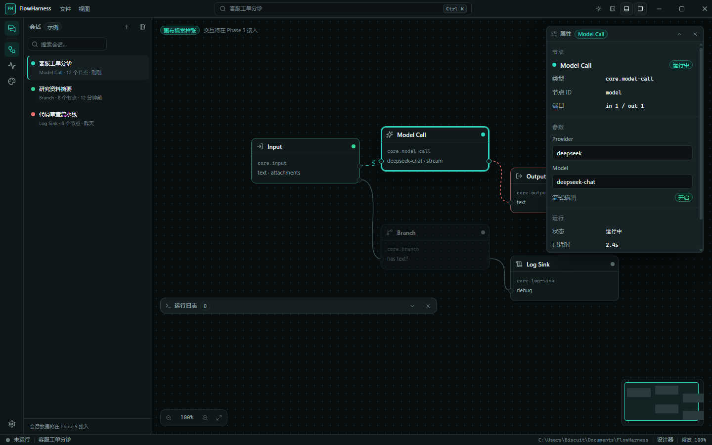

# 2026-11-24 09:10 — Step 2：内部浮动 Panel

## 目标

在 Shell v2 的画布上加入 Dear ImGui 式内部浮动面板：

- `PanelFrame`：Header / Body / 可选 Footer；
- `FloatingPanel`：拖动、缩放、z-index 聚焦、折叠、关闭、位置钳制；
- `PanelLayer`：容器内布局与默认位置；
- 接入运行日志、属性检查；
- 补窗口 bounds 持久化（step 2 开头约定）。

## 实现

- `shell/panels/useFloatingPanels.ts`：open / collapsed / x / y / width / height / z 状态；
- `PanelFrame`：32px Header，拖拽手柄、标题、可选 badge、折叠/关闭；Body 滚动；Footer 可选；
- `FloatingPanel`：Header 拖动；右/下/右下三个缩放手柄；z-index 聚焦；容器边界钳制；
- `PanelLayer`：绝对铺在 Main 上，指针事件只作用于面板；默认属性右上、运行日志左下；
- `InspectorContent` / `RunLogContent`：从旧固定 Inspector / BottomPanel 抽出的内容；
- TitleBar 增加运行日志 / 属性检查开关；命令中心与 `Ctrl J` 同步；
- 面板仅在设计器且已选中会话时渲染；Hero / 诊断 / 样式指南不显示。

## 交互验证（CDP 实际鼠标事件）

```text
拖动属性面板：left 796 → 812（右边界钳制），top 16 → 56，z-index 4
缩放运行日志：560×260 → 630×276；y 为默认值时底边距保持不变
折叠属性：460 → 32；展开：32 → 460
关闭运行日志：DOM 移除；TitleBar 重新打开：DOM 恢复
```

## 截图

默认（属性右上 / 运行日志左下）：



折叠运行日志：



## 窗口 bounds 持久化

- `services/window-state.ts`：`SavedWindowState` + 校验（宽高下限、有限数值）；
- `WindowStateStore` 写入 `userData/window-state.json`，损坏/缺失返回 null；
- `createWindow(saved)`：按显示器 workArea 校验可见性，钳制 x/y/尺寸；最大化状态恢复；
- resize/move 400ms 防抖保存；maximize/unmaximize/close 立即保存；
- 3 个单测：缺失、往返、损坏/过小。

## 验证

```text
pnpm typecheck → 0
pnpm test      → 10 files / 43 tests
pnpm build     → 0
pnpm smoke     → OK
```

## 已知限制

- 面板位置不持久化（内存态；后续写入 Workbench UI state）；
- 不做 docking / 分屏；只做浮动；
- 属性/运行日志内容仍是示例数据；
- 属性面板默认会遮住画布右侧节点，可拖动/折叠。

## 下一步

Step 3：SciFi 节点组件、端口、连线与基础动画（并入 Phase 3 Canvas core/view）。
