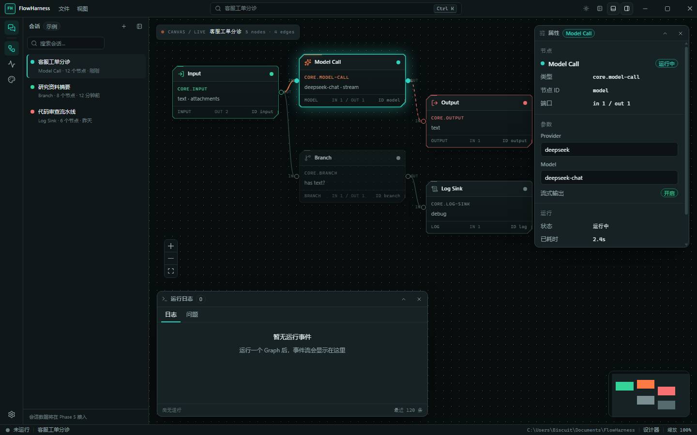
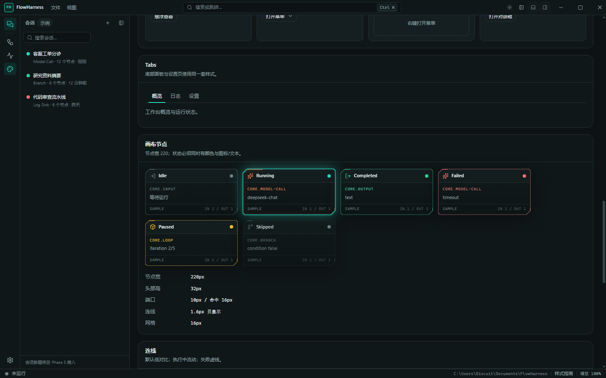

# 2026-11-24 09:20 — Step 3：SciFi 画布（React Flow）

## 目标

把静态画布样张替换为真实受控画布：

- SciFi 节点组件、端口、连线；
- 活跃连线/节点基础动画；
- Canvas core（几何、边 key、命令）+ 单测；
- React Flow 视图、节点 renderer registry、MiniMap / Controls / 右键菜单；
- 并入 Phase 3 的 core/view。

## 实现

### 依赖

- `@xyflow/react` **12.12.1**（稳定版；13.x 在当前环境表现异常，退回 12）。
- 仅 `canvas/view` import React Flow；core 保持纯 TS。

### Canvas core

- `types.ts`：`CanvasNode`、`CanvasEdge`、`CanvasStatus`、`CanvasNodeData`；
- `geometry.ts`：screen/world 变换、点包含、矩形相交；
- `edge-key.ts`：`source:handle->target:handle` 稳定 key；
- `commands.ts`：边去重、删节点联动删边、移动节点；
- 新增 5 个 core 单测（geometry 2 / commands 3）。

### Canvas view

- `CanvasView`：受控 `useNodesState` / `useEdgesState`、连接、删除、右键菜单；
- 默认视口 `{x:24,y:28,zoom:1}`，节点左对齐，避免默认属性面板遮住 Output；
- `node-registry`：`kind → renderer`，默认 `SciFiNode`，可按节点类型覆盖；
- `NodeVisual`：与 Styleguide 共用；切角 frame、等宽 kind/ID、状态点、energy 橙 running、accent 青绿 selected；
- `SciFiNode`：左右端口、Handle、IN/OUT 标签；
- `SciFiEdge`：贝塞尔、活跃 energy 流动虚线、失败 danger 虚线、端点；
- MiniMap（状态色块）、Controls（抬到运行日志面板上方）、画布状态条、右键菜单；
- 移除 `canvas-preview/`，Styleguide 改用 `NodeVisual`。

### 视觉 token

- 新增 `--fh-energy` / `-soft` / `-glow`（暗色 `#ff7a45`，亮色 `#c2410c`）；
- energy 只用于节点运行态与活跃连线；danger 仍为红。

## 交互验证（CDP）

```text
nodes: 5  edges: 4  handles: 7
拖动 input：translate(24,72) → translate(32,80)（snap 16）
点击 output：selected=true
右键画布：自定义菜单打开
缩放控件：viewport 改变
选中 output + Delete：nodes 5→4，edges 4→3
```

## 重要修复：窗口遮挡导致后台节流

在调试中一度出现“DOM 中节点 visibility:hidden、edge layer 为空，但截图仍有画面”的矛盾：
窗口被全屏窗口遮挡后 Chromium 暂停了布局/测量，React Flow 处于未测量态，截图只是旧帧。

- 给 `capture:ui` 与测试启动增加：
  `--disable-backgrounding-occluded-windows`、`--disable-renderer-backgrounding`、`--disable-background-timer-throttling`；
- 之后 nodes/edges 正常测量，截图与 DOM 一致。

## 截图





## 验证

```text
pnpm typecheck → 0
pnpm test      → 12 files / 48 tests
pnpm build     → 0
pnpm smoke     → OK
```

## 已知限制

- 尚未接 `GraphDocument adapter` / 节点库 / 撤销栈（Phase 3.5）；
- 画布选择尚未同步到属性 Panel（当前 Panel 内容是示例 Model Call）；
- 边右键菜单、复制/撤销、300 节点性能基线未做；
- 当前默认视口是固定的 1x 左对齐，窗口很窄时需要后续自适应。

## 下一步

Phase 3.5：GraphDocument ⇄ CanvasDocument adapter、节点库、属性 Panel 随选择联动、校验/问题面板。
