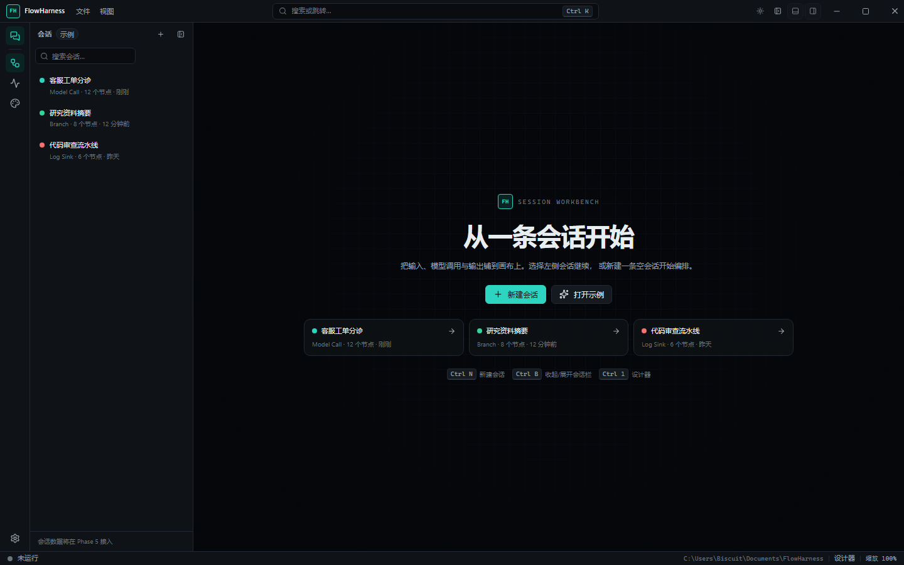
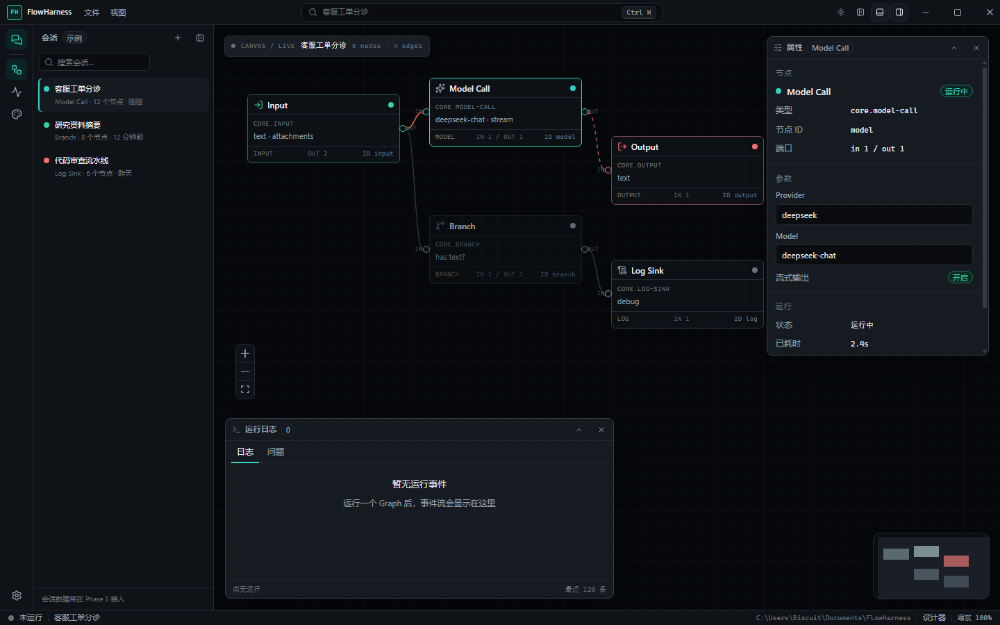
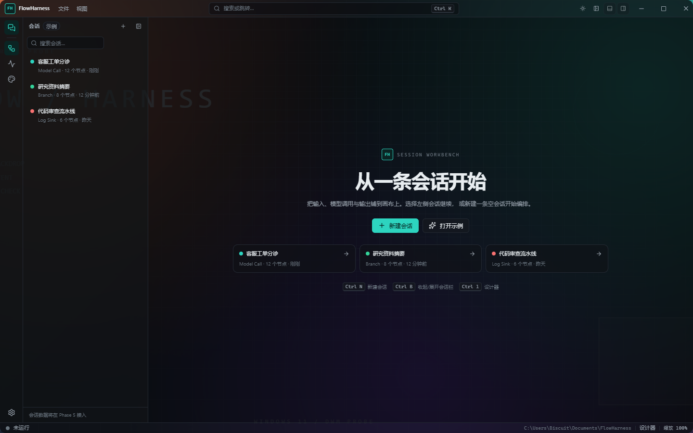

# 2026-11-24 09:35 — Step 4：中性配色 + 真透明

## 目标

按用户确认的方向：

- **真透明 + 背景模糊**；
- 全局改为**中性黑 + 青绿语义 + 橙能量**；
- 在 Phase 3.5 之前完成，不再跳步。

## 4A 配色与表面

- 深色 token 从青绿倾向改为中性石墨：
  `#07080a` → `#0a0c0f` → `#0f1216` → `#151920` → `#1a1f27`；
- 文本/边框改中性冷灰；
- 青绿只保留给选中、焦点、链接、少量强调文字；
- `--fh-energy` 保留给节点运行态与活跃连线；
- TitleBar / Ribbon / Sidebar / Panel / StatusBar / Hero 统一使用同一套 token；
- Hero 的装饰光从青绿改为极低透明度 energy 光；
- 亮色 token 同步改为中性灰（视觉走查未做）。

## 4B 真透明与平台限制

### 已落地

- 默认窗口改为 `transparent: true`、`frame: false`、`backgroundColor: transparent`；
- 透明模式内容 alpha：
  - 背景 0.5、canvas 0.42、surface 0.68、raised 0.74、overlay 0.88、node 0.94；
- 极淡 scanline 叠加、1px inset 边框；
- PanelFrame 使用 84% alpha（后续实测 `backdrop-filter` 在透明窗口中会压成黑块，已移除）；
- fallback：`FLOWHARNESS_WINDOW_MODE=frameless` 回到不透明无边框。

### 关键发现：桌面 blur 当前不可实现

1. **CSS `backdrop-filter`**：在透明窗口中不采样桌面/其他窗口。用受控渐变背景对比，
   `blur(24–28px)` 与 `none` 的截图完全一致（无模糊）。
2. **原生 Acrylic / Mica**：Electron 45 + Win11 26H2 下实际仍为不透明；加不加
   `transparent` 都无可见材质。
3. **DWM `SetWindowCompositionAttribute`**（AccentState 3/4）：外部 spike 调用返回成功，
   但窗口无 blur 效果；属于未文档化接口，不再继续。

结论：当前交付为 **真透明（桌面清晰透出）+ 磨砂纹理/半透明面板**；不做桌面模糊。
详见 ADR-009。若后续必须桌面 blur，需要原生模块或桌面捕获方案，单独评估。

## 截图

中性配色 Hero：



中性配色 Canvas + Panels：



真透明（受控渐变背景，桌面清晰透出）：



## 验证

```text
pnpm typecheck → 0
pnpm test      → 12 files / 48 tests
pnpm build     → 0
pnpm smoke     → OK
```

截图链路：

- `capture:ui` 默认以 opaque frameless 启动，保证 renderer 截图可读；
- 真透明截图需要 GPU + 系统屏幕抓取（`--disable-gpu` 会退化为不透明）。

## 已知限制

- 桌面清晰、不模糊（平台限制）；
- 透明窗口没有原生阴影，只保留 1px inset 边框；
- 忙碌桌面上的正文可读性需要用户实际验收；
- 亮色主题只改了 token，未做视觉走查；
- 透明窗口在远程/受限会话中可能退化。

## 下一步

Phase 3.5：GraphDocument adapter、节点库、属性 Panel 随选择联动、撤销/复制、校验/问题面板。

## 4C 反馈后的商务扁平收口（同日）

用户确认整体方向后提出 7 点细节，已全部落地：

1. 节点改 6px 圆角商务扁平，去掉切角/工业风；Header 28、body/footer 间距收紧（字号不变）；
2. 背景网点改成 24px 网格线，亮度降低；
3. 浮动 Panel 改为 84% alpha，圆角 8（透明窗口下 backdrop blur 会变黑，已移除）；
4. 选中只换 accent 边框，移除辉光；
5. 节点去掉渐变，改纯色底；
6. 降低青绿/橙红频率：running 节点图标/kind 中性、Hero 装饰光移除、CANVAS live dot 中性、Panel badge 中性；energy 只保留活跃连线；
7. 透明窗口内容区 12px 圆角（scanline 同步裁切）。

截图已更新为 `step4-neutral.png` / `step4-canvas.png` / `step4-glass.png`。验证：typecheck / 48 tests / build / smoke 全绿。