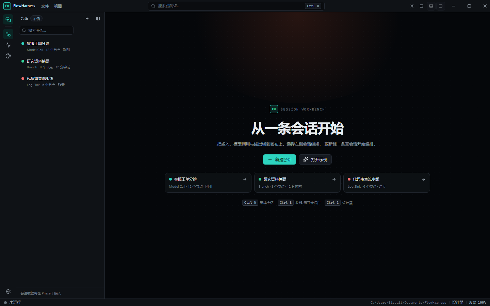
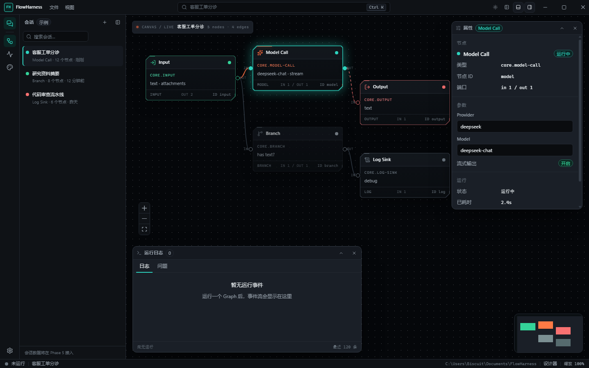
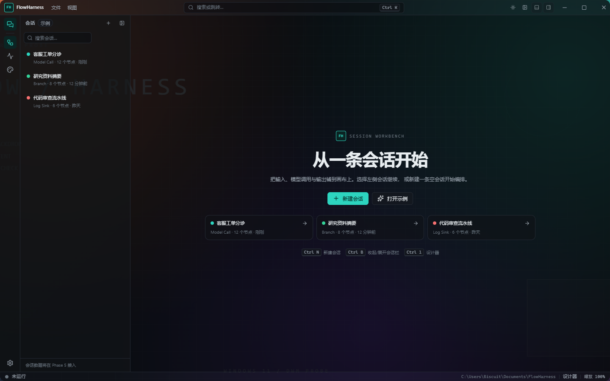

# 开发日志 — 2026-11-24

> 本会话只保留这一篇。只记录实际交付，不记录过程、排错和实现细节。

## 本会话贡献

### 工程基础

- 搭建 pnpm workspace + Electron + TypeScript + Vite 的开发与构建链路；
- wireclaw 以 submodule 纳入，并作为普通包依赖使用；
- 提供 Windows 一键启动脚本，兼容受限沙箱环境；
- 打通类型检查、测试、构建、启动验证链路。

### 架构与契约

- 完成分层架构、模块职责、数据模型、执行/IPC、UI 与开发环境文档；
- 建立设计契约与架构决策记录；
- 定义 contracts 包，统一 IPC 通道、DTO 与错误码。

### 主进程能力

- 本地数据层：配置、密钥、对象存储、工作区、文件宿主；
- 工作区导入导出、并发锁、原子写与迁移；
- 本地运行宿主与运行记录：启动、暂停、恢复、取消、事件流、checkpoint；
- 审批与用户输入 IPC 往返；
- 窗口状态持久化。

### 工作台 UI

- 完成基础工作台框架与 VS Code 逻辑的 Shell；
- 无边框窗口与自绘标题栏、Ribbon、会话侧栏、Hero、状态栏；
- 内部浮动 Panel：拖动、缩放、层级、折叠、关闭；
- 运行日志与属性检查两个工作面板；
- 快捷键、命令中心与会话侧栏收起/拖宽。

### 画布

- 基于 React Flow 的可交互画布；
- 节点、连线、端口、状态表达、小地图、缩放控件与右键菜单；
- 商务扁平节点与紧凑布局；
- 低亮度网格背景；
- 画布与主题、尺寸约定对齐。

### 主题与透明

- 中性黑全局配色；青绿只做语义强调，橙红只保留在关键区域；
- 默认真透明窗口，面板半透明，窗口内容圆角；
- 节点与连线改为纯色、扁平边框，移除渐变和辉光；
- 提供不透明无边框 fallback；
- 记录当前平台无法模糊桌面的限制。

### 质量

- 12 个测试文件 / 48 个测试通过；
- 类型检查、构建、启动验证通过；
- 架构、设计、readme、todo 与开发日志同步。

## 当前状态

- Step 4（配色 + 真透明 + 商务扁平）已完成；
- 下一步：Phase 3.5 — GraphDocument adapter、节点库、检查器联动、撤销/复制、校验；
- 已知限制：桌面 blur 不可用；亮色主题视觉走查、300 节点性能基线、真实桌面可读性验收未完成。

## 视觉基线

