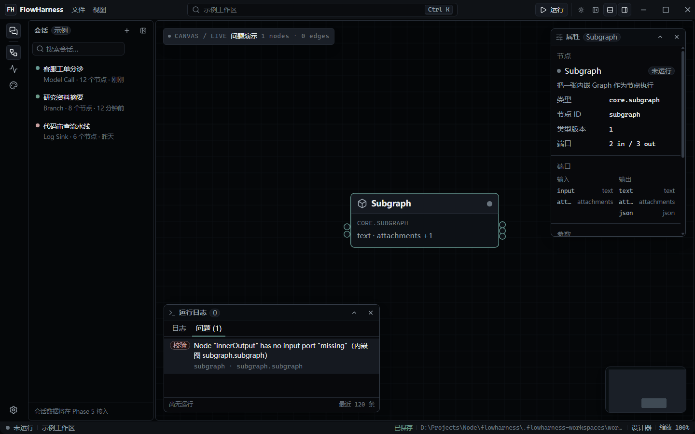

# 开发日志 — 2026-11-25（M3）

> 本会话只保留这一篇。只记录实际交付，不记录过程、排错和实现细节。
> 同日更早的 M2 记录见 [2026-11-25-06-42.md](./2026-11-25-06-42.md)。

## 本会话贡献

### Wireclaw — 内嵌图递归校验

- `GraphNode` 新增 `embeddedGraphs` 契约；Subgraph / Loop / ForEach 从 `config.graph` 暴露内嵌图，解析失败不抛错，交给父图定位；
- `Graph.validate()` 递归校验内嵌图（深度上限 8），内层问题回填容器 `nodeId`、`graphPath`（如 `subgraph.<id>/loop.<id>`）、`nestedNodeId` / `nestedPort` / `nestedEdgeIndex`；
- `GraphValidateOptions.requirements` 随递归下传：内层节点的 provider / model / tool / parameter 缺失可以在设计期定位；
- `GraphNode.collectRequirements()` 汇总节点自身与内嵌子图依赖；run 预检与编辑器目录都能看到容器节点的内层 requirements，序列化仍只写自身声明；
- `HarnessIssue` 增加 `graphPath` / `nestedNodeId` / `nestedEdgeIndex` / `nestedPort`；
- 新增 `test/harness-nested-validation.ts`；Subgraph 非法内嵌图由运行前 `assertValid()` 以 `InvalidGraph` 拦截。

### FH — 问题面板与运行可视化

- 新增 `designer/core/problems.ts`：汇总 `Graph.validate()`、失效连线与运行错误；问题带 `nodeId` / `edgeId` / `graphPath`，并按边去重；
- 运行日志面板「问题」页签从占位改为真实列表：校验 / 连线 / 运行来源徽标、位置信息、点击选中并聚焦节点；
- `CanvasView` 增加 `focusNode` 请求，配合 `fitView` 定位问题节点；
- `run-events` 同时投影节点与边：`node:start` 点亮入边、`node:end` 点亮出边、`node:error` 标记相连边、`run:end` 清理 active；暂停中取消会清掉 `paused` 节点；
- `validateGraphDocument` 支持 `requirements` catalog，并递归获得内嵌图问题；
- `findInvalidEdges` 输出两侧节点 id，供问题面板定位。

### FH — 暂停 / 继续

- preload / `bridge.d.ts` 暴露 `pauseRun` / `resumeRun`（main handler 已存在）；
- `useDesignerRun` 增加 `pause` / `resume` / `controlling`，暂停/继续后同步节点投影；
- `RunControls` 增加 `canPause` / `canResume` / `isPaused`；TitleBar 按状态显示「运行 / 暂停 / 继续」与「取消」；
- 运行中与暂停中都禁用画布编辑，避免恢复时使用过期文档。

### 工程与文档

- `capture:ui` 新增 `designer-problems` 场景：写入内嵌非法子图的文档，重载后打开问题页签并定位；
- 新增问题面板视觉基线 `devlog/assets/ui-designer-problems.png`；
- 同步 README / 架构 / 设计 / TODO / wireclaw Harness 文档。

### 验证

- wireclaw：66/66 离线测试通过（新增 `harness-nested-validation`）；
- FH：25 个测试文件 / 121 项测试通过（新增 `problems`，扩展 `run-events` / `validate`）；
- `pnpm typecheck`、`pnpm build`、`pnpm smoke` 通过；
- 手工验证：内嵌子图错误在问题面板显示 `graphPath`，点击定位并聚焦容器节点。

## 当前状态

- M3 完成：问题面板、内嵌图递归校验、运行事件→节点/边状态、暂停 / 继续、取消清理；
- 下一步：M4 文档生命周期与编辑体验（多图、撤销 / 重做、复制粘贴、未保存保护）；
- 已知限制：requirements catalog 尚未接 Provider / Secrets；`run:start` 的整图呼吸、`node:stream` 文本流与 `custom` 动画仍待细化；暂停/恢复只在进程内，跨重启 resume 属 M6。

## 视觉基线

