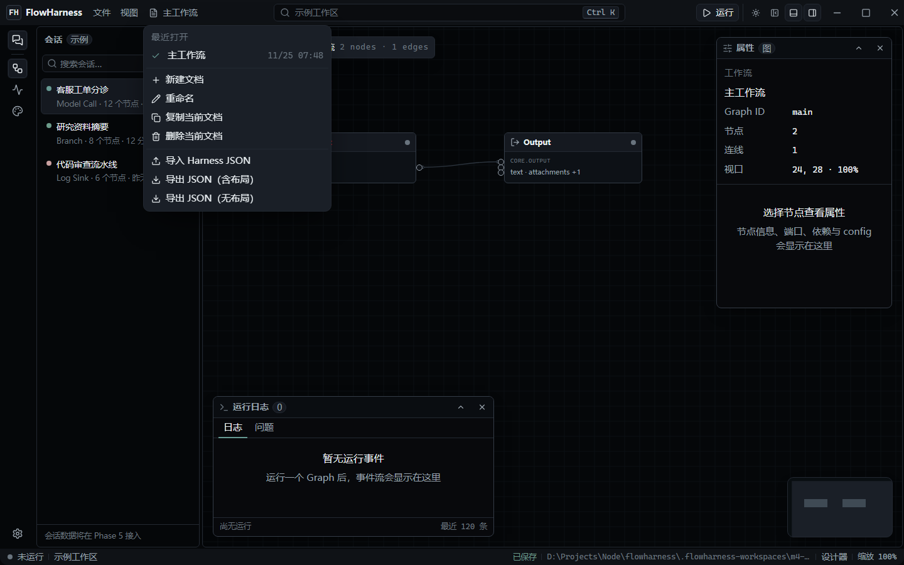
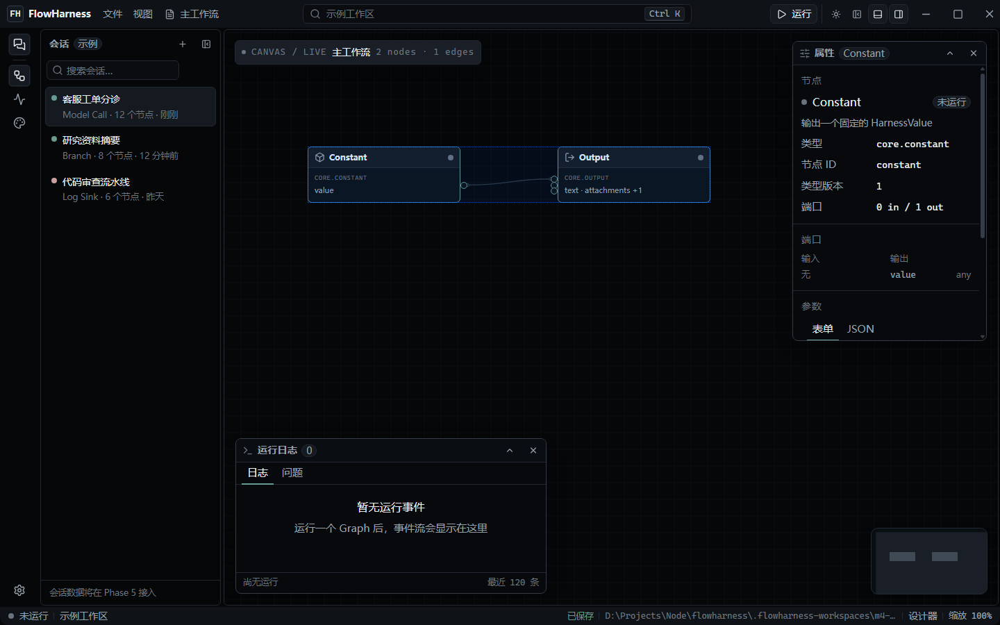
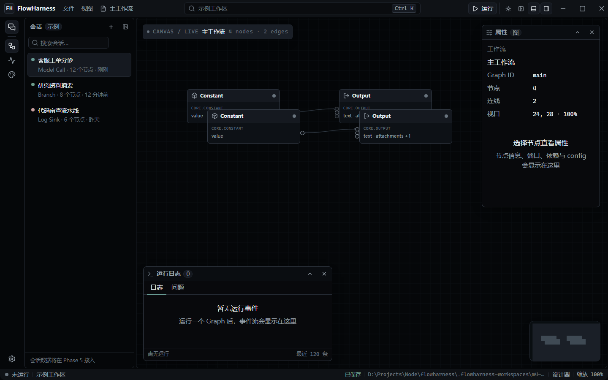
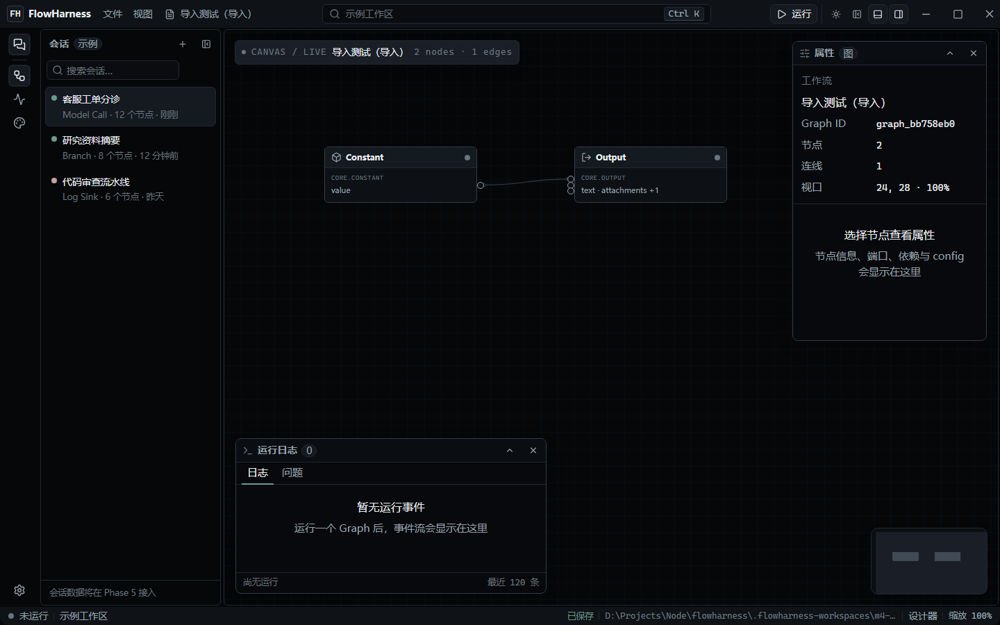
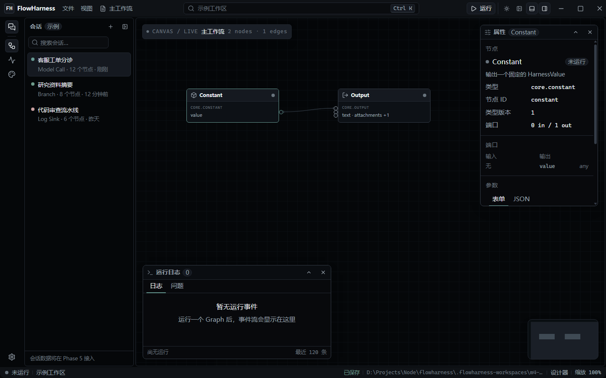

# 开发日志 — 2026-11-25（M4）

> 本会话只保留这一篇。只记录实际交付，不记录过程、排错和实现细节。
> 同日更早的 M3 记录见 [2026-11-25-07-10.md](./2026-11-25-07-10.md)。

## 本会话贡献

### 画布交互

- 左键拖拽改为框选（`selectionOnDrag` + `SelectionMode.Partial`），Ctrl / Meta 追加选择；
- 中键 / 右键拖拽平移；右键拖动后抑制上下文菜单，普通右键单击仍弹出；
- `CanvasView` 改为多选模型（`selectedNodeIds` / `onSelectionChange`），选中项供检查器、删除、复制使用。

### 多图与文档生命周期

- contracts / preload / bridge：新增 `workspace:listDocuments`、`workspace:deleteDocument`、`workspace:exportHarness`；
- `WorkspaceStore.listDocuments` 扫描 `documents/harness/*.json`，标题取自文档、损坏文件回退文件名；`deleteDocument` 删除单文档；
- 新增标题栏文档菜单 `shell/DocumentMenu.tsx`：文档列表 + 最近打开 + 新建 / 重命名 / 复制 / 删除 / 导入 / 导出（含布局 / 无布局）；
- `useDesignerDocument` 接受 `documentId`，每份文档独立 revision、自动保存与撤销栈；
- App 维护文档列表 / 当前文档 / 最近打开（按工作区 localStorage）；切换、新建、重命名、复制、删除、导入均接通 main；
- 导出改为 main 原生保存对话框（`workspace:exportHarness`），导入使用文件选择后新建文档。

### 编辑体验

- 撤销 / 重做：最多 100 条，Ctrl+Z / Ctrl+Shift+Z / Ctrl+Y；config 连续输入 800ms 合并；视口变化不进撤销栈；
- 复制 / 粘贴：选中节点及其内部边，重映射 id、偏移 48px；Ctrl+C / Ctrl+V；
- 检查器与画布多选联动；删除、撤销后自动清理失效选中项。

### 保存保护

- `SaveCoordinator.flush()` 在无修改时不再重复写盘，返回最终 `SaveState`；
- 切换文档、关闭窗口（标题栏关闭 / Ctrl+W）、新建/复制/导入前先 flush；失败则停留并提示；
- 保存冲突仍由 revision 检测；新增「另存为副本」恢复入口；
- 外部修改通过保存时 `E_CONFLICT` 暴露。

### 工程与文档

- `capture:ui` 新增 `designer-documents` / `designer-doc-flow` / `designer-import` / `designer-history` / `canvas-selection` / `canvas-pan` 场景；
- 新增 M4 视觉基线：文档菜单、框选、复制粘贴结果、导入结果、设计器基线；
- 同步 README / 架构 / 设计 / TODO；M5 增加「节点内联编辑 + 从其他节点拖拽传入」条目。

### 验证

- FH：27 个测试文件 / 135 项测试通过（新增 workspace 文档列表/删除、copy/paste、recent-documents、harness-json、SaveCoordinator 空 flush）；
- `pnpm typecheck`、`pnpm build`、`pnpm smoke` 通过；
- 脚本化手工验证：框选选中 2 个节点；右键拖动节点位移 443→603 且无菜单，随后右键单击正常弹出「添加节点 / 适配视图」；文档新建 → 重命名 → 复制 → 删除列表正确；导入生成「导入测试（导入）」；复制粘贴 2→4、撤销回 2、重做回 4。

## 当前状态

- M4 完成：多图文档、撤销重做、复制粘贴、框选 / 右键平移、Harness JSON 导入导出、切换/关闭前保存保护；
- 下一步：M5 Workbench Framework，并把「节点内联编辑 / 从其他节点拖拽传入参数」纳入 M5；
- 已知限制：系统级关闭（Alt+F4）未做退出握手；撤销栈重启后不保留；导出原生对话框未做自动化验收；工作台切换入口随 M5。

## 视觉基线

