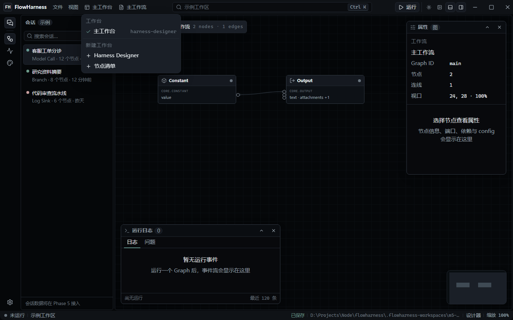
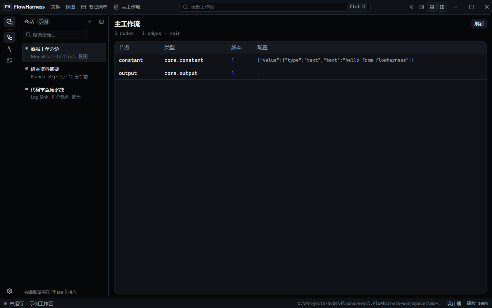
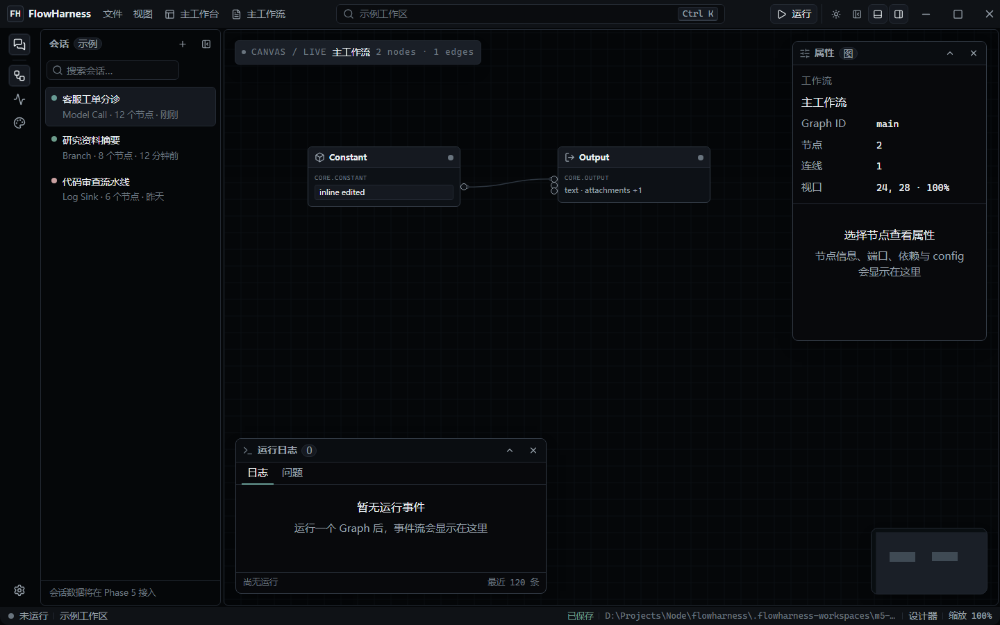

# 开发日志 — 2026-11-25（M5.1）

> 本会话只保留这一篇。只记录实际交付，不记录过程、排错和实现细节。
> 同日更早的 M4 记录见 [2026-11-25-07-46.md](./2026-11-25-07-46.md)。

## 本会话贡献

### Workbench Framework

- `packages/contracts` 新增 `WorkbenchInstanceDocument` / `WorkbenchPlan` / `WorkbenchSummary`；`workspace:listWorkbenches` 通道；
- `WorkspaceStore.listWorkbenches` 扫描 `documents/workbenches/*.json`，实例文档复用通用 `readDocument` / `saveDocument`；
- 新增 `renderer/src/workbench/`：
  - `WorkbenchDefinition`（type / title / description / canOpen / View）；
  - `WorkbenchController`（status / undo / redo / run / pause / resume / cancel / save）；
  - registry 与 `WorkbenchHost`（按实例 type 选择 View，未知类型降级为空状态）；
  - `instance.ts`：创建 / 校验实例、主图绑定与兼容性检查；
- 设计器作为 `harness-designer` 注册；新的 `graph-table` 工作台以只读表格复用同一实例文档与 Host，验证框架可插拔；
- 设计器通过 Shell 上报 `WorkbenchController`，把运行控制、撤销栈、保存收口到统一契约。

### 工作台切换

- TitleBar 新增 WorkbenchMenu：列出实例、显示 active、按 registry 生成「新建工作台」项；
- 每个工作区自动创建一个 `harness-designer` 实例，绑定当前主图；实例主图失效时自动回退到有效文档并写回；
- 切换工作台前 flush 当前文档；切换后由 WorkbenchHost 重建 View，面板与运行控件按工作台类型显隐。

### 节点内联编辑

- `CanvasView` 节点数据增加 view-only 的 config 回调；`NodeVisual` 支持内联控件；
- 节点 Body 直接编辑：
  - Constant：文本常量；
  - Model Call：mode（chat / generate）与 temperature；
  - Log：日志级别；
- 配置写入仍走 `updateNodeConfig` → 撤销栈 → 400ms 自动保存；
- 其他节点继续显示摘要，检查器表单仍是完整编辑入口。

### 工程与文档

- `capture:ui` 新增 `designer-workbenches` / `designer-workbench-flow` / `designer-workbench-return` / `designer-inline` 场景；
- 新增 M5 视觉基线：工作台菜单、节点清单工作台、内联编辑；
- 同步 README / 架构 / 设计 / TODO；M5 标记为进行中（M5.1 完成）。

### 验证

- FH：27 个测试文件 / 136 项测试通过（新增 workspace 工作台列表、workbench instance）；
- `pnpm typecheck`、`pnpm build`、`pnpm smoke` 通过；
- 脚本化手工验证：
  - 打开工作区自动生成 `wb_*`「主工作台」；
  - 新建「节点清单」后列表含两个实例、表格 2 行；
  - 切回「主工作台」后节点数 2、属性面板恢复；
  - Constant 内联输入写入 `{"value":{"type":"text","text":"inline edited"}}` 且状态栏显示「已保存」。

## 当前状态

- M5.1 完成：Workbench 定义 / 实例文档 / registry + host / controller / 第二工作台 / 三类高频节点内联编辑；
- M5 剩余：`WorkbenchPlan`（独立多 run 编排）、独立参数槽拖拽、更多高频节点 NodeContent；
- 已知限制：工作台实例暂不支持重命名 / 删除 UI；`layout.overrides` 尚未接线；参数传入仍走端口 Handle。

## 视觉基线

