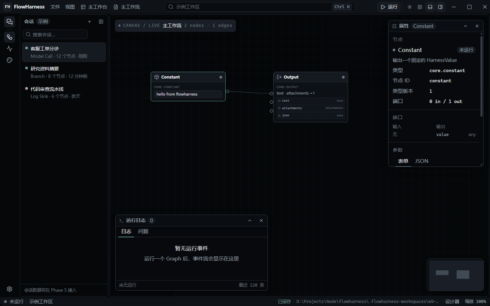
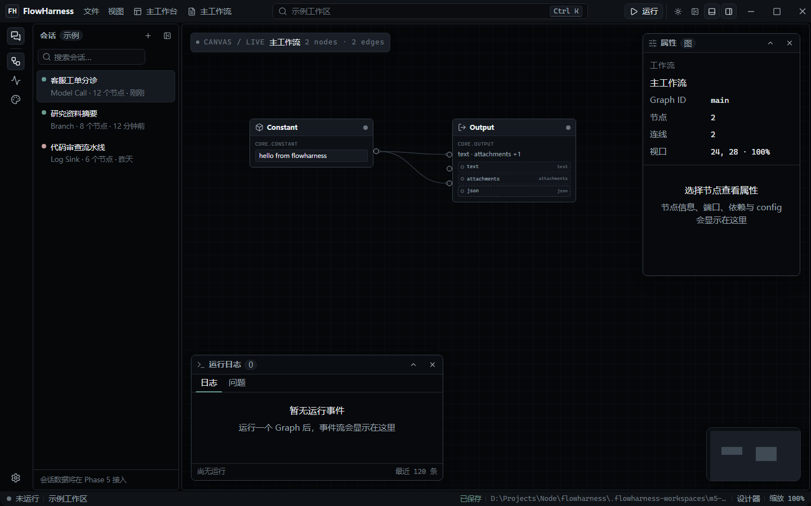
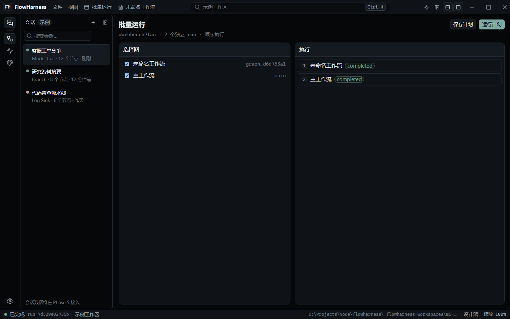

# 开发日志 — 2026-11-25（M5.2）

> 本会话只保留这一篇。只记录实际交付，不记录过程、排错和实现细节。
> 同日 M5.1 见 [2026-11-25-08-04.md](./2026-11-25-08-04.md)，输入/框选修复见 [2026-11-25-08-21.md](./2026-11-25-08-21.md)。

## 本会话贡献

### WorkbenchPlan 与第三个工作台

- 新增 `workbench/plan.ts`：顺序计划创建、`planGraphIds`、结构校验；
- 新增 `plan-runner` 工作台「批量运行」：勾选多个图 → 保存 `plan.graphs` → 顺序启动独立 run，轮询 `run:get` 直到终态；步骤状态与错误可见；
- 计划持久化进 `WorkbenchInstanceDocument.plan`，复用实例自动保存；
- WorkbenchHost / registry 现在托管三个工作台：`harness-designer` / `graph-table` / `plan-runner`。

### 节点 Body 输入端口槽

- `NodeVisual` 在节点 Body 内渲染输入端口槽（端口名 + 类型），带 `data-input-port`；
- `CanvasView` 监听 `onConnectStart` / `onConnectEnd`：连线可落在左侧 Handle，也可落在 Body 输入槽；落点通过 `data-node-id` + `data-input-port` 解析并发出 `connect` 命令；
- 保留左侧 Handle，不改变已有连线与视图语义。

### 更多高频节点内联编辑

- 新增 Value（参数名 / 必填）、Agent Run（权限 / 最大步数）、Loop（最大迭代）、ForEach（结果端口）节点内联控件；
- Constant 仍使用 IME 安全的本地 draft 输入。

### 工作台实例生命周期

- WorkbenchMenu 支持重命名 / 删除当前实例；
- 删除 active 实例后自动重建默认 `harness-designer` 实例；
- 删除只移除实例文档，不影响绑定的 Harness 图。

### 工程与文档

- vitest include 增加 `workbench/**/*.test.ts`，Workbench 单测纳入验证链；
- 新增 `designer-plan-runner` / `designer-slot-connect` / `designer-workbench-manage` 截图场景；
- 同步 README / 架构 / 设计 / TODO；M5 标记为完成，主线更新为 M6。

### 验证

- FH：30 个测试文件 / 143 项测试通过（新增 workbench plan / instance）；
- `pnpm typecheck`、`pnpm build`、`pnpm smoke` 通过；
- 脚本化手工验证：
  - 从 Constant 输出拖到 Output 的 `json` 输入槽，落盘 edges 从 1 条变为 2 条且目标端口为 `json`；
  - 批量运行两个图，步骤 1 / 2 均为 `completed`；
  - 工作台重命名成功；删除 active 实例后自动重建「主工作台」。

## 当前状态

- M5 完成：Workbench 定义 / 实例 / 三个工作台 / WorkbenchPlan 顺序执行 / 节点内联编辑 / 输入端口槽 / 实例重命名删除；
- 已知限制：Plan 编排目前在 renderer 侧，`plan.bindings` 与 `layout.overrides` 未接线，框架级统一工具栏仍待后续；
- 下一步：M6 Session / Provider 闭环。

## 视觉基线

