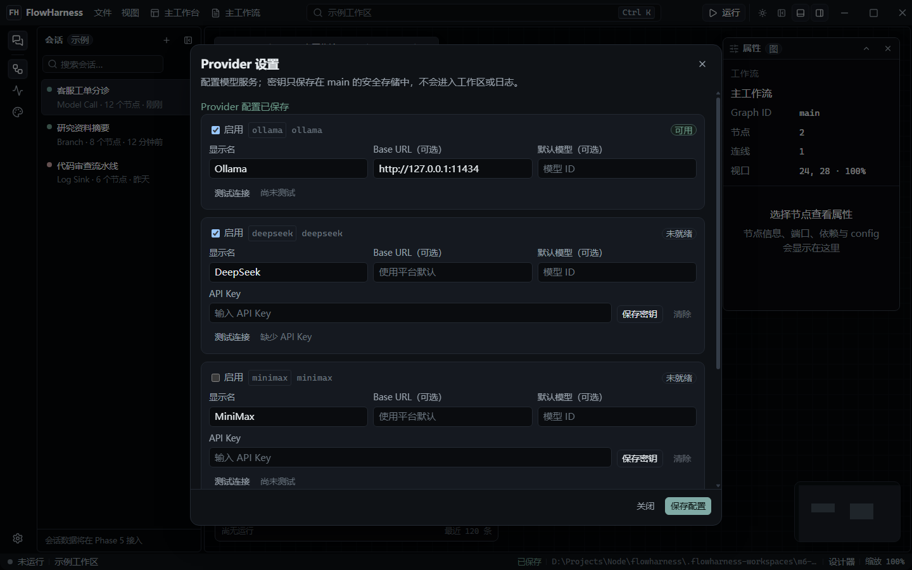
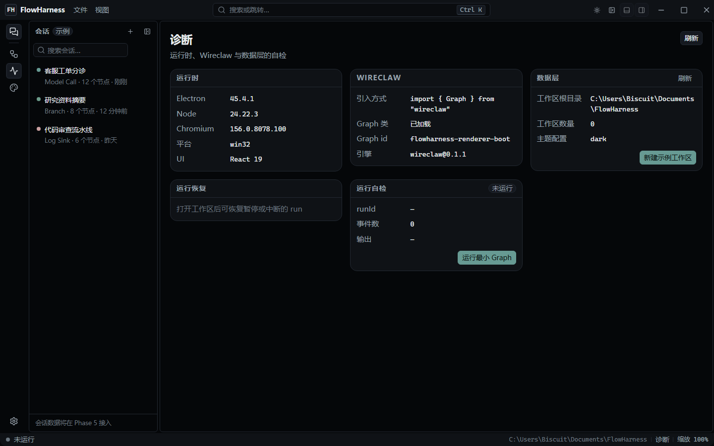

# 开发日志 — 2026-11-25（M6.1）

> 本会话只保留这一篇。只记录实际交付，不记录过程、排错和实现细节。
> 上一阶段见 [2026-11-25-08-39.md](./2026-11-25-08-39.md)。

## 本会话贡献

### wireclaw 云端同步确认

- 开始前 fetch 并比对：`HEAD = origin/main = 618b547`，无 remote-only / local-only 提交；
- 父仓库与 submodule 工作树均干净。

### Provider 配置、Secrets 与设置页

- contracts 新增 `ProviderConfig` / `ProviderStatus` / `ProviderTestResult`，`AppConfig.providers` 持久化非敏感配置；
- 默认 Provider：Ollama（启用）、DeepSeek / MiniMax / Qwen（未启用）；
- 新增 `main/services/provider-registry.ts`：
  - 按 `kind` 构造 DeepSeek / Ollama / MiniMax / Qwen Provider；
  - 云 Provider 缺少密钥时标记不可用；Ollama 不需要密钥；
  - `reload()` 在配置 / 密钥变化后重建实例；`test()` 拉取模型目录；
- `RuntimeHost.resolveProvider` 改为查询 ProviderRegistry，模型 / Agent 节点不再固定失败；
- preload 暴露 `secrets:has/set/delete`、`providers:list/test`；renderer 永远拿不到密钥明文；
- 新增 `shell/ProviderSettingsDialog.tsx`：启用、显示名、Base URL、默认模型、API Key 保存/清除、测试连接；Ribbon 设置菜单进入。

### 审批 / 用户输入 UI

- main 已广播的 `approval` / `input` topic 接入 App；
- 新增 `shell/InteractionDialogs.tsx`：
  - ApprovalDialog：展示工具名与参数 JSON，批准 / 拒绝；
  - UserInputDialog：单选 / 多选 / 其他文本，提交或取消；
- preload 暴露 `approval:respond` / `input:respond`，超时仍由 main 兜底。

### 跨重启恢复

- `RunStartRequest` 支持 checkpoint；`RuntimeHost.start` 透传给 wireclaw `Graph.run`；
- 新增 `RuntimeHost.resumeInterrupted(workspaceId, runId)`：从 RunStore 装载 graph + checkpoint 后重新 start；
- `RunStore.updateStatus` 持久化 paused / running；Diagnostics 新增「运行恢复」面板，列出 paused / interrupted run 并可恢复；
- `run:list` 合并内存 run 与磁盘记录，重启后仍能看到中断记录。

### 验证

- FH：31 个测试文件 / 149 项测试通过（新增 ProviderRegistry、RuntimeHost fake provider、跨重启恢复）；
- `pnpm typecheck`、`pnpm build`、`pnpm smoke` 通过；
- 脚本化验证：
  - Provider 设置页展示 4 个 Provider，Ollama 可用、云 Provider 未就绪；
  - 启用 DeepSeek 并保存，`config:get` 读回 `enabled: true`；
  - Diagnostics 展示「运行恢复」面板；
  - RuntimeHost 集成测试：Model → Model Call → Output 图使用 fake provider 完成并输出文本。

## 当前状态

- M6.1 完成：Provider 工厂 / Secrets / 设置页 / 审批输入 / 跨重启恢复；
- M6 剩余：Session 生命周期、历史、附件回放；真实 ToolRegistry；wireclaw checkpoint 的 graph hash / node type version；
- 运行前 requirements catalog 尚未接入 ProviderRegistry，校验阶段不会提前拦截缺失 Provider。

## 视觉基线

