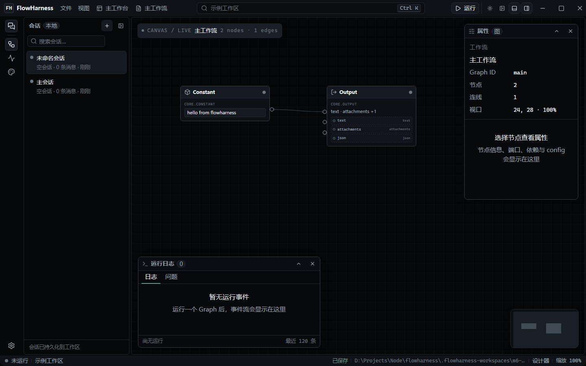

# 开发日志 — 2026-11-25（M6.2）

> 本会话只保留这一篇。只记录实际交付，不记录过程、排错和实现细节。
> 上一阶段见 [2026-11-25-10-01.md](./2026-11-25-10-01.md)。

## 本会话贡献

### wireclaw checkpoint v2

- `GraphCheckpoint` 升级到 v2：新增 `graphHash` 与顶层 `nodeVersions`；
- 新增 `harness/runtime/fingerprint.ts`：对可执行图定义（不含 ui / title / metadata）做稳定指纹，节点按 id、边按端口地址排序；
- 恢复时校验 graphId、graphHash、nodeVersions；不一致抛 `InvalidCheckpoint`；
- wireclaw 测试：66/66 通过；子模块提交 `e6b1345 feat(harness): fingerprint graph checkpoints`。

### 工作区工具

- 新增 `workspace-tools.ts`：每个工作区注册 `LocalToolProvider`；
- Agent 可用 `workspace__readFile` / `workspace__writeFile`，写文件走审批；
- RuntimeHost 的 `toolsFor` 按工作区注入，关闭工作区时清理。

### 运行前依赖目录

- renderer 在打开工作区 / 窗口聚焦时读取 `providers:list`，构造 `RequirementCatalog`（provider + 已测试的模型）；
- `useDesignerRun` 把 catalog 传给 `validateGraphDocument`，缺失 Provider / 模型会在运行前报出。

### Session 生命周期

- contracts 新增 `SessionRecord` / `SessionSummary` 与 session IPC；
- 新增 `SessionStore`：`sessions/<id>/session.json`，支持默认会话、创建 / 列表 / 读取 / 保存；
- `SessionService` 按工作区装配 SessionStore；
- Session Sidebar 改为读取真实工作区会话，新建会话写入 main 并刷新列表；
- 当前历史消息是 opaque JSON，附件索引内联在记录中；回放 UI 未接。

### 验证

- FH：33 个测试文件 / 155 项测试通过（新增 session-store、workspace-tools）；
- wireclaw：66/66 通过；
- `pnpm typecheck`、`pnpm build`、`pnpm smoke` 通过；
- 脚本验证：新工作区自动生成「主会话」；点击新建后侧栏出现「未命名会话」与「主会话」。

## 当前状态

- M6.2 完成：checkpoint 完整性、工作区工具、运行前依赖目录、Session 生命周期；
- 剩余：Session 历史消息序列化 / 附件回放 UI；MCP 等更多工具 Provider；Session history 与 wireclaw SessionHistory 的正式对接。

## 视觉基线

