# 开发日志 — 2026-11-25（M2）

> 本文件覆盖 M2 及其后续（节点库、schema 表单、预设、一致性收口、UI 打磨）。只记录实际交付，不记录过程、排错和实现细节。
> 同日更早的 UI 打磨与 M1 记录见 [2026-11-25.md](./2026-11-25.md) 与 [2026-11-25-m1.md](./2026-11-25-m1.md)。

## 本会话贡献

### Wireclaw — 节点元数据与目录

- `NodeTypeDefinition` 增加 `defaultConfig` / `category` / `keywords`，注册时做 JSON 安全与字符串校验；
- `toDescriptor` 透出新字段，并修复 `requirements` 在 catalog 中丢失的问题；
- 16 个内建节点补齐分类与关键词，11 个补齐 `configSchema`；Subgraph / ForEach / Loop 的默认 `config.graph` 指向最小 Input → Output 子图；
- 新增 `editor/schema.ts`：JSON Schema 子集校验（`validateNodeConfig`）与默认值收集（`defaultConfigFromSchema`），不引入 ajv；
- `GRAPH_EDITOR_CATALOG_VERSION` 升到 2，目录透出 schema / 默认 config / 分类 / 关键词；
- `test-runner` 兼容 pnpm 的 esbuild 布局（平台二进制相对 esbuild 包解析）。

### FH — 节点库与配置表单

- 设计器目录改用 `createEditorCatalog(registry, { presets })`，类型默认 config 深拷贝后写入新节点；
- 画布内新增节点库浮层：最近使用（≤6 条，localStorage）+ 预设 + 按分类分组 + 标题/类型/关键词搜索；入口为画布右键菜单「添加节点」，浮层锚定在右键位置；移除原「添加节点」平铺菜单；
- 检查器按节点 `configSchema` 渲染表单，保留「JSON」页签作为兜底；字段级错误来自 wireclaw 子集校验；
- 新增表单原语 `Field` / `Select` / `Checkbox` / `NumberField`，并在 Styleguide「表单控件」段展示；
- 新增 `config-path` 深路径读写（不可变、删除空壳父级）；
- 内置 3 条节点预设（文本常量 / 聊天模型调用 / 只读 Agent），插入时写参数默认值。

### 工程与文档

- `capture:ui` 新增 designer-form / designer-form-edit / designer-schema / designer-preset / designer-library / designer-menu / styleguide-form 场景，并适配右键菜单与 JSON 页签；
- 节点库面板限高 380px，内容超出时内部滚动（细滚动条），节点库锚定右键位置；
- 投影时检测失效连线（节点/端口不存在），画布顶部提示并在可渲染的边上使用 error 样式；
- 新增 ADR-017（configSchema 子集 + 默认 config + catalog v2）；
- 同步 README / 架构 / 设计 / TODO / wireclaw 文档。

### UI 打磨（2026-11-25）

- 浮动面板加深：新增 `--fh-panel-bg` / `--fh-panel-header-bg`（比 `--fh-node-bg` 更深），PanelFrame 与节点库浮层共用；alpha 仍由 `--fh-panel-alpha` 控制；
- 表单 Select 从原生 `<select>` 改为 Radix DropdownMenu 触发器 + 主题化选项（选中勾、键盘与关闭行为由 Radix 负责）；
- Checkbox 改为自绘方框（隐藏原生控件），选中态使用主色描边与勾，保留 `focus-visible` 与禁用态；
- Styleguide 表单控件段同步新外观。

### 代码一致性收口（2026-11-25）

- 画布几何统一由 `CANVAS_METRICS` 写入根节点 CSS 变量：节点宽 / Header 高、端口 10px + 24px 热区、边宽 1.4px、网格 24px；`Background gap` 与 `snapGrid` 共用 `gridSize`；
- 删除 `react-flow__handle` 的 min-size 覆盖与散落在 CSS/组件里的节点/端口/边常量；
- 面板：属性默认 280×432（与 `PANEL_MIN_WIDTH` 一致），折叠高度与 `PanelFrame` 共用 `PANEL_HEADER_HEIGHT=34`；
- 侧栏 token 对齐为 260px / 200–360；
- 新增 `layout-metrics.ts` 统一面板/侧栏契约，并补充一致性测试；
- Styleguide 连线样张改为 1.4px / 3 10 / 5 5，与画布一致。

### 验证

- wireclaw：65/65 离线测试通过（新增 `harness-schema.ts`）；
- FH：24 个测试文件 / 109 项测试通过（新增 edges / catalog / config-path / presets / recent-nodes / layout-metrics）；
- `pnpm typecheck`、`pnpm build`、`pnpm smoke` 通过；
- 手工验证：节点库插入节点写入默认 config；预设插入写入 `{ text: "hello" }`；表单编辑与 JSON 编辑均能自动保存；手工破坏端口后出现失效连线提示。

## 当前状态

- M2 完成：节点库（最近使用 / 预设 / 分类 / 搜索）、configSchema 表单、默认 config、失效连线提示；
- 剩余：能力/成本提示（`catalog` 还没有成本与延迟元数据）；
- 已知限制：HarnessValue、内嵌 GraphDocument、`hostTools` 等复杂字段仍以 JSON 文本域编辑；表单每次输入直接触发文档更新与自动保存（未做字段级 debounce）；内建节点端口全静态，动态端口机制已具备但没有节点使用。

## 视觉基线

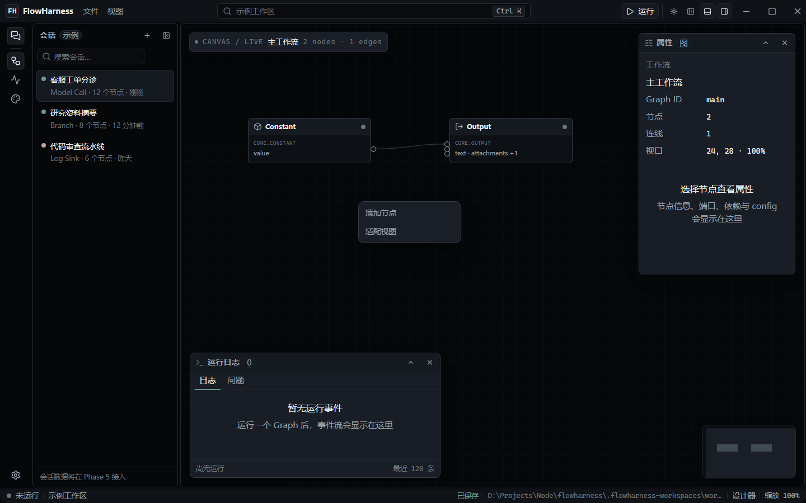

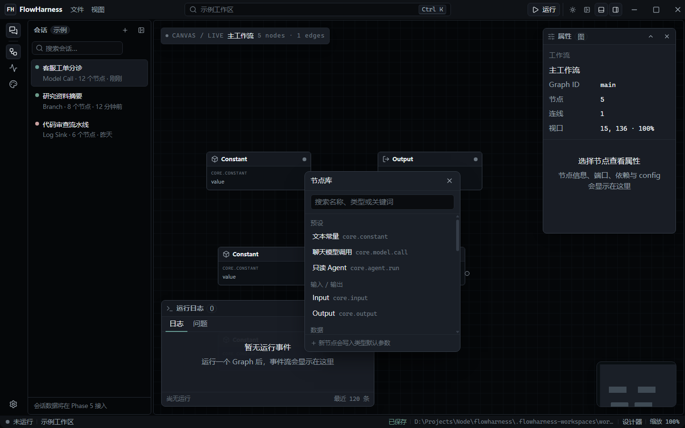

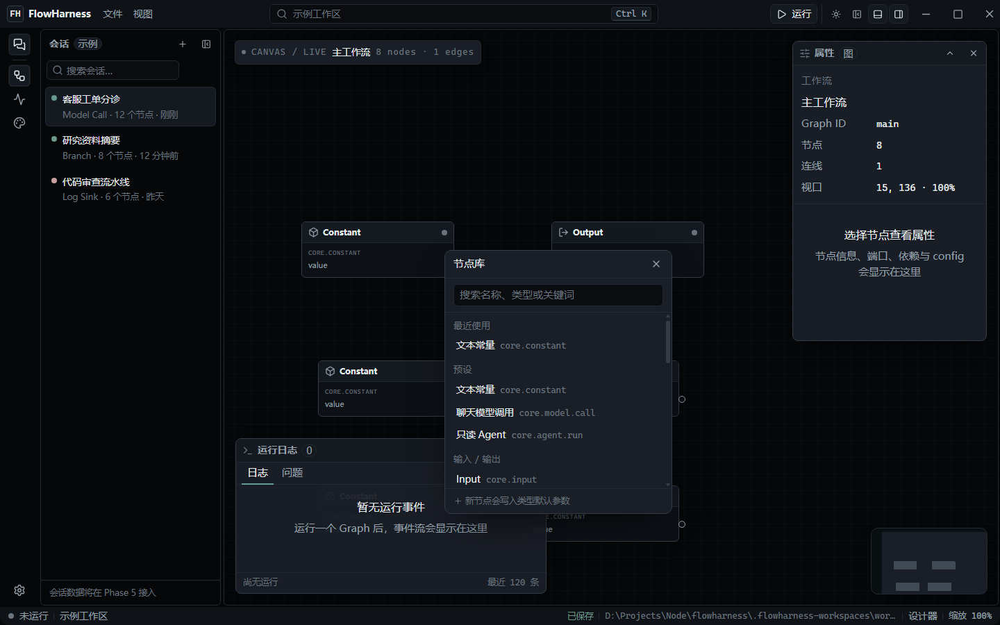

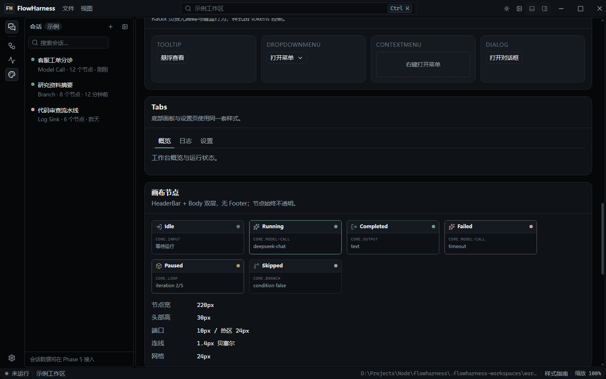

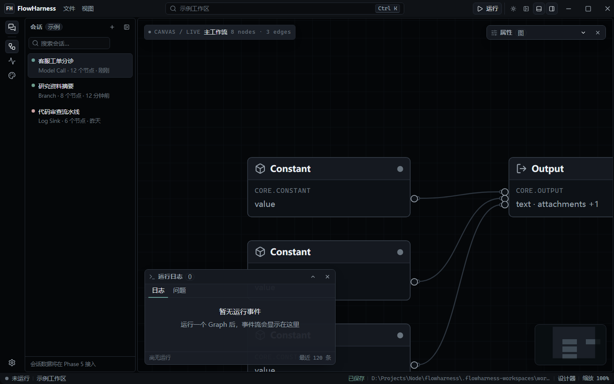

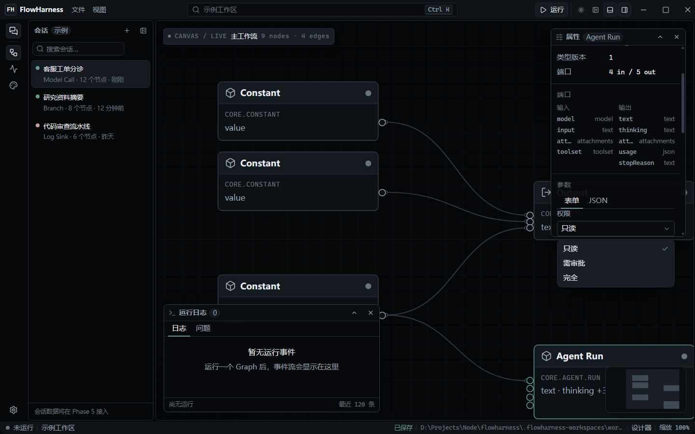

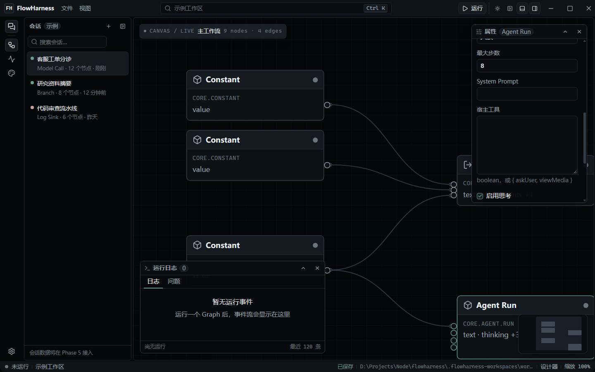

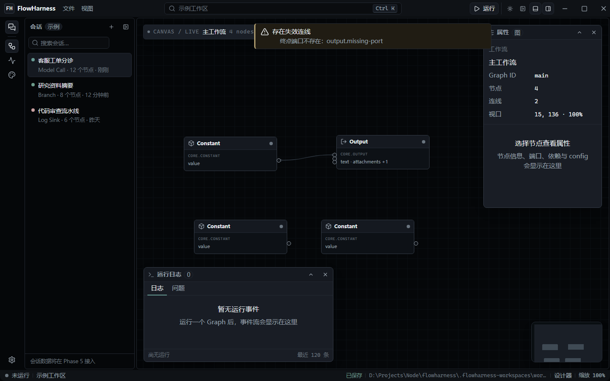

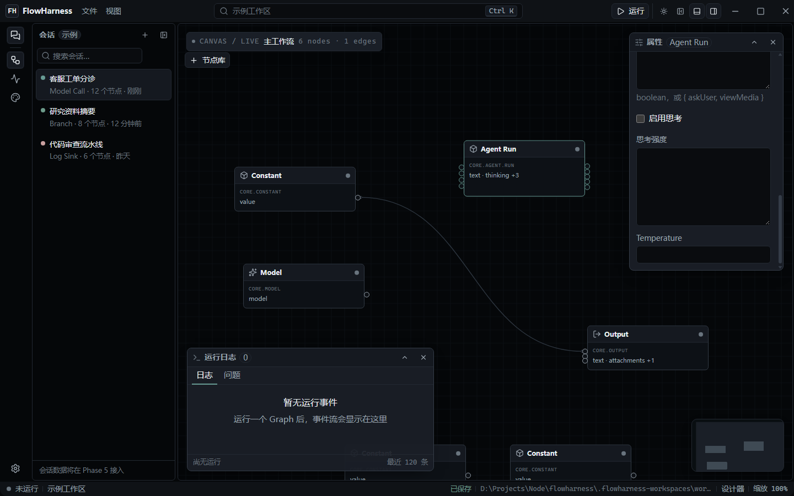

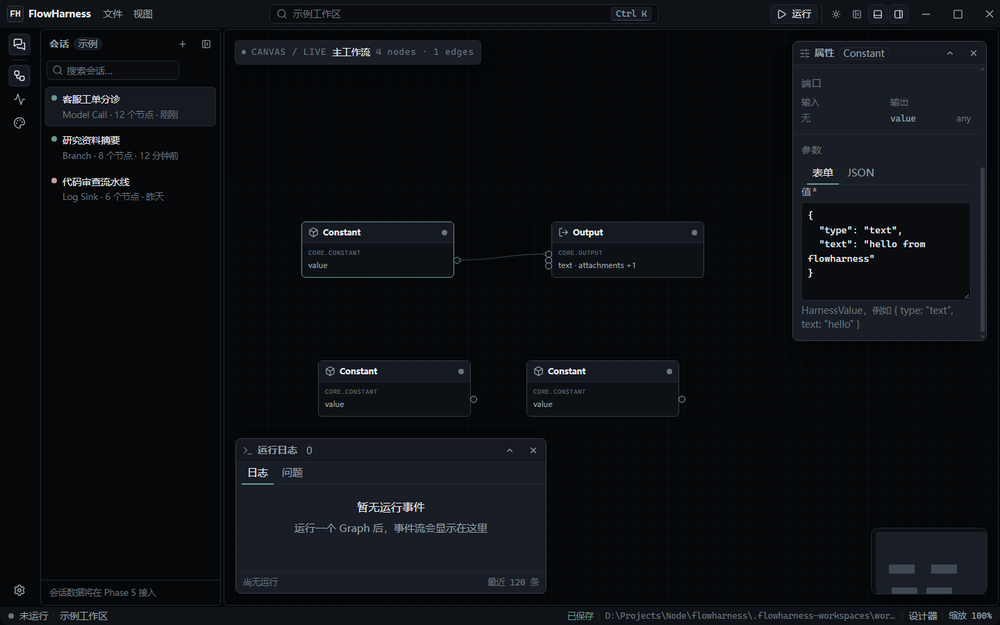

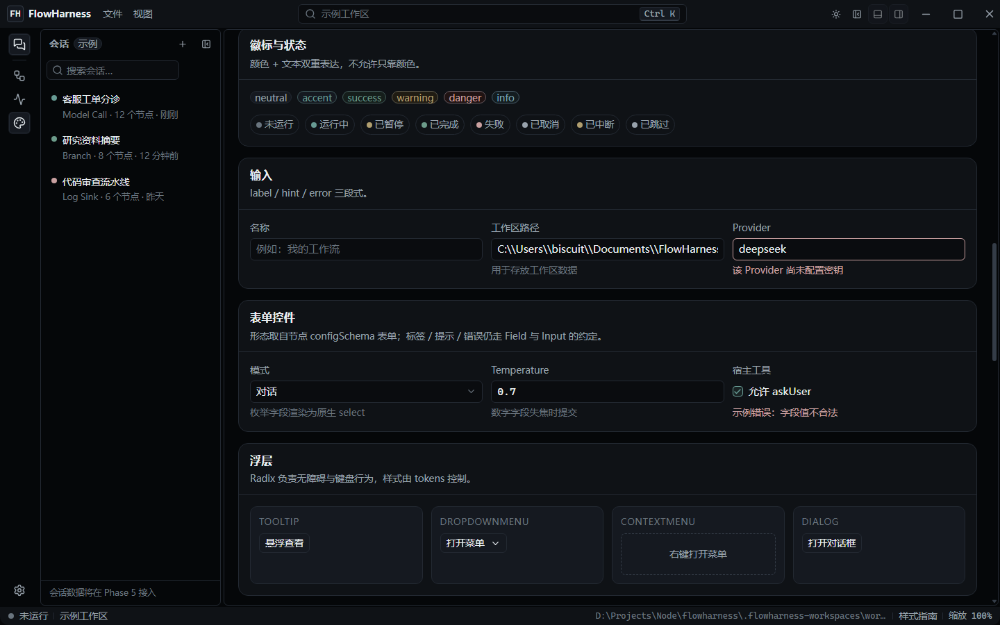
