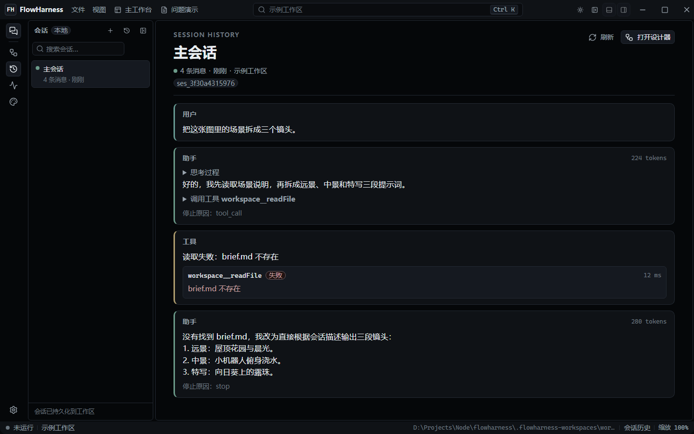

# 开发日志 — 2026-11-26（M6.3 Session 历史回放）

> 本会话只保留这一篇。只记录实际交付，不记录过程、排错和实现细节。
> 上一阶段见 [2026-11-25-10-23.md](./2026-11-25-10-23.md)。

## 本会话贡献

### 文档对账

- 按当前代码修正 architecture / readme / todo 中的过期表述：Workbench Framework 现状、审批 / 输入 renderer 接线、requirements catalog 注入、SessionStore 装配、`interrupted` 标记、contracts 清单、Canvas selection、M4 撤销勾选。

### Session 历史序列化

- `SessionStore` 用 wireclaw `SessionSerializer` 校验并规范化 `history`；`SessionRecord.history` 固定为 `SessionData`（version / id / messages / isArchived）；
- 保存时从历史派生 `messageCount` 与 `attachments`（`collectAttachmentHashes` + SHA-256 过滤）；非法历史返回 `E_INVALID_ARGUMENT`；
- M6.2 的空数组在读取 / 保存时迁移为空会话；
- preload / bridge 暴露 `blob:stat`，供附件元信息查询。

### 会话历史视图

- 新增 `views/SessionHistoryView` 与 `shell/session-history` 投影（wireclaw 校验 → 消息 / 工具调用 / 附件模型）；
- 回放用户 / 助手 / 系统 / 工具消息：思考、token 用量、工具调用参数、成功 / 失败、耗时、结构化结果、停止原因；
- 附件用 `blob:stat` + `fh-asset://` 渲染图片与文件卡片；
- 入口：侧栏历史按钮、Ribbon「会话历史」、TitleBar 视图菜单、Ctrl+4；含空态 / 错误态 / 刷新；
- 进入历史视图时刷新会话列表，避免侧栏摘要停留在旧计数。

### 验证

- FH：33 个测试文件 / 157 项通过（新增 `session-history` 投影测试；扩展 `session-store` 历史校验 / 迁移 / 派生测试）；
- `pnpm typecheck` / `pnpm build` / `pnpm smoke` 通过；
- 视觉基线：`capture:ui` 新增 `session-history` 场景（CDP 注入 4 条消息后截图）。

## 视觉基线

