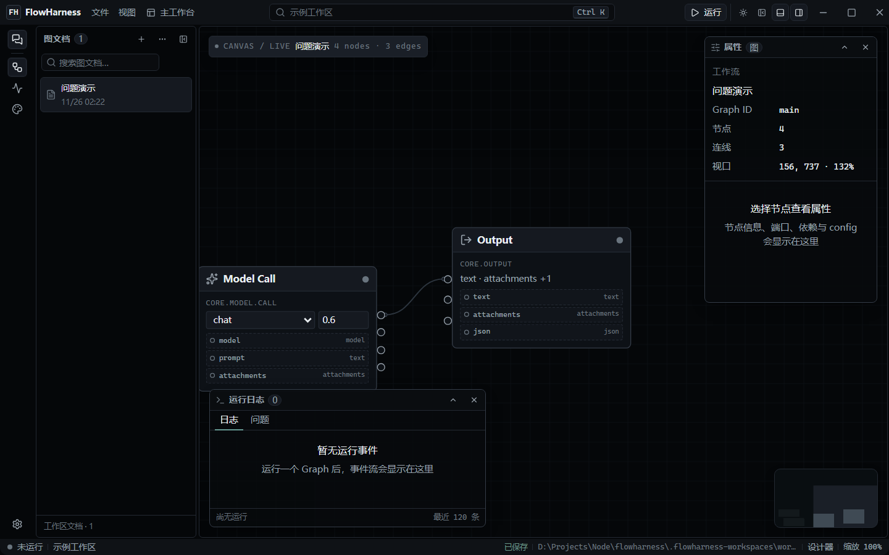
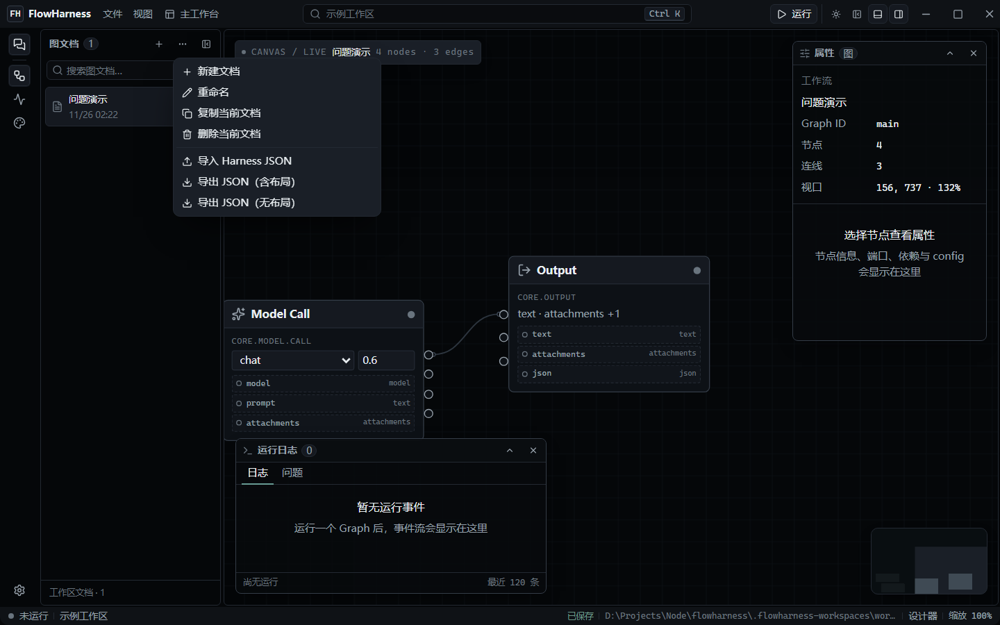

# 开发日志 — 2026-11-26（M7.0 / M7.1 工作台导航）

> 本会话只保留这一篇。只记录实际交付，不记录过程、排错和实现细节。
> 上一阶段见 [2026-11-26-01-48.md](./2026-11-26-01-48.md)。

## M7.0 设计定稿

- ADR-019：工作台作用域导航；工作台 = 视图 + 绑定 + 导航，GraphDocument / Session / Blob / Run 归 workspace；左栏 PanelContent 由 `(workbench type, mode)` 决定；Session 改为递归文件夹树；设计→运行为同一实例的 design/run 模式。
- ADR-020：wireclaw `RunResult` v1 聚合 `model-call` / `session` entries；FH `SessionRecord.kind` 区分 conversation / run；run session 存 RunResult，不伪造消息。
- 同步 [data-model.md](../architecture/data-model.md) §12、[ui.md](../architecture/ui.md) §11、[modules.md](../architecture/modules.md) §18、[overview.md](../architecture/overview.md)、readme 与 todo；旧 M7/M8/M9 顺延为 M8/M9/M10。

## M7.1 壳层导航宿主

- `WorkbenchDefinition` 增加 `navigation`（design / run 槽位）与 `WorkbenchNavigationProps`；`WorkbenchHost` 增加 `panelLayer` 槽。
- 新增 `shell/navigation/`：
  - `NavigationPanel`：标题 / 动作 / 内容 / 页脚 / 拖宽 / 收起；
  - `DocumentNavigation`：GraphDocument 列表（搜索 / 新建 / 文档操作），复用 `DocumentMenu` 动作；
  - `PlanNavigation`：Plan 步骤列表。
- App 按当前工作台渲染左栏；设计器左栏 = GraphDocument，plan-runner 左栏 = Plan 步骤；移除全局 SessionSidebar、顶层 sessions 视图与 Ctrl+4。
- `DocumentMenu` 支持 icon 触发与 `showList=false`，供导航动作菜单复用。
- 文档选择统一在 App 层同步 `WorkbenchInstance.graphs` 的 primaryGraph；删除 graph 前扫描工作台引用，返回 `E_CONFLICT`。
- 浮动面板 `--fh-panel-alpha` 0.95 → 0.78；TitleBar / StatusBar 固定 chrome 不变。
- 会话 UI 暂时退出壳层：`SessionSidebar` / `SessionHistoryView` 文件保留但未挂载；M7.3 以 Session 树 + 历史面板恢复。

## 验证

- FH：34 个测试文件 / 159 项通过（新增 `workbench/registry` 导航解析、`workspace-store` 删除引用检查）；
- `pnpm typecheck` / `pnpm build` / `pnpm smoke` 通过；
- `capture:ui` 重新生成设计器导航基线，文档操作菜单可用。

## 视觉基线

